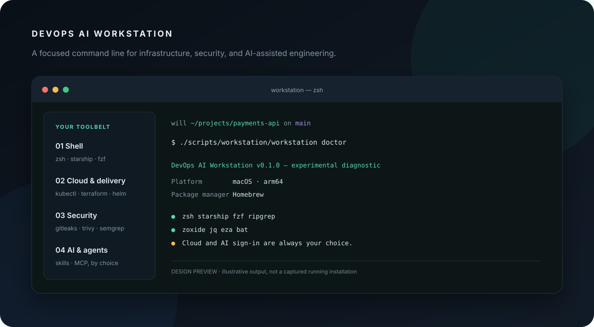

<div align="center">

# DEVOPS AI WORKSTATION

### Your engineering environment, composed with intent.

**A practical, safety-first starter for DevOps, security, and AI-assisted work.**  
macOS · Linux · WSL2 &nbsp; / &nbsp; Ghostty preferred · Windows Terminal on native Windows

[Get started](#get-started) · [What’s inside](#the-workstation) · [Roadmap](docs/ROADMAP.md) · [Contributing](CONTRIBUTING.md)



**v0.1.0 · Experimental starter · Apache-2.0**

</div>

---

## A calmer command line for serious work

The goal is one coherent workstation: a fast shell, useful navigation, cloud and Kubernetes tooling, security checks, and AI coding assistants—with clear boundaries around what gets installed and what still needs your choice.

This repository is the first, intentionally small foundation. The visual above is a **design preview**, not a screenshot of a completed installation. Profiles for cloud and AI, native Windows setup, and several tool installers are still on the roadmap.

## Get started

Copy this command to clone the project and start the interactive installer:

```bash
git clone https://github.com/WillRaido/devops-ai-workstation.git && cd devops-ai-workstation && ./install.sh --profile base
```

On Windows, open PowerShell in WSL2 and run the same command. For a native Windows terminal, use Windows Terminal; native PowerShell setup is not implemented yet.

The installer walks through the choices in the console. It checks for existing base tools and Ghostty, offers to install missing tools, lets you select individual tools, choose a Ghostty theme, and optionally set a custom Zsh welcome message such as `WillDevOps`. It previews the plan and asks before applying it. Already installed packages are skipped. Existing Zsh and Starship configuration files are preserved; if you opt into the welcome message, the installer backs up an existing `.zshrc` before adding its startup hook.

On macOS, Homebrew installs selected tools. On Linux, the wizard detects apt, dnf, or pacman but does not install packages yet; it never invokes `sudo`. If Ghostty is detected or you choose to install it through Homebrew, you can select Nord, Dracula, Catppuccin Mocha, or Gruvbox Dark. When a Ghostty config already exists, the installer saves a timestamped backup before changing its theme. Other platform package integrations and full cloud/security/AI profiles remain planned.

You can also pass choices directly, for example `./install.sh --with zsh,starship,fzf --theme Nord --welcome WillDevOps`. Run `./install.sh --help` to see options. Review the scripts before running them if you want to see exactly what they do.

### Check your setup

```bash
./scripts/workstation/workstation doctor
```

The `doctor` command reports platform and shell-tool availability. It does not inspect credentials or sign in to cloud services.

## The workstation

| Layer | Included in the starter | Status |
| --- | --- | --- |
| **Shell** | Zsh, Starship, zoxide, fzf, ripgrep, jq, eza, bat, Atuin, tmux | Base profile; Homebrew installs on macOS |
| **Cloud & delivery** | AWS CLI, Azure CLI, gcloud, kubectl, Helm, K9s, kubectx, Terraform/OpenTofu, Terragrunt, Docker/Podman, Ansible, Packer | Cataloged; managed profile planned |
| **Security** | CodeQL, Semgrep, Gitleaks, OSV-Scanner, Trivy, Grype, Syft, Cosign, Checkov, TFLint, actionlint, Zizmor, GitHub CLI | Cataloged; managed profile planned |
| **AI** | Claude Code, Codex CLI, Cursor, Gemini CLI, Aider | Cataloged; managed profile planned |
| **Agent Skills** | Terraform review, GHAS triage, Kubernetes operations (`SKILL.md`) | Starter examples included |
| **MCP** | Least-privilege catalog guidance | Documentation only; no servers start automatically |

Commands `install` and `doctor` work in this starter. `update`, `cloud`, `security`, `ai`, `theme`, `skills`, `mcp`, and `clean` clearly report that they are planned.

## Built around trust

- **You stay in control:** no credentials, cloud logins, or MCP servers are provisioned or started.
- **No privilege surprises:** no automatic `sudo`; Linux package installation is left to the user.
- **Your settings are respected:** existing Zsh and Starship configuration is preserved.
- **No hidden download pipeline:** no `curl | bash`; inspectable scripts live in this repository.
- **Honest support status:** package coverage varies by platform, and this starter has not been tested on real macOS, Linux, or Windows machines.

## Explore

- [Architecture and platform behavior](docs/ARCHITECTURE.md)
- [Tool inventory and installation status](docs/MANIFEST.md)
- [MCP least-privilege guidance](docs/MCP-CATALOG.md)
- [Roadmap](docs/ROADMAP.md)

---

<div align="center">

**A useful workstation should feel intentional—and stay understandable.**

</div>
