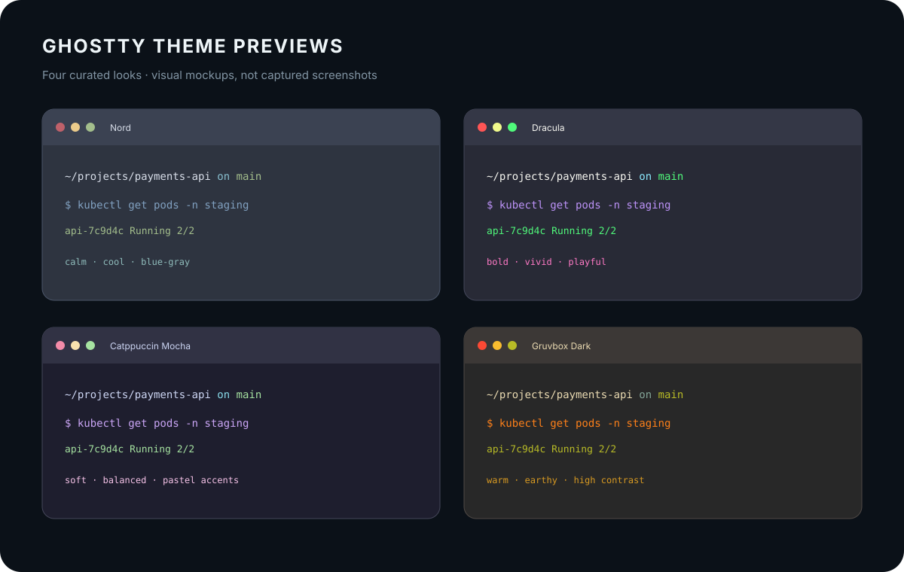
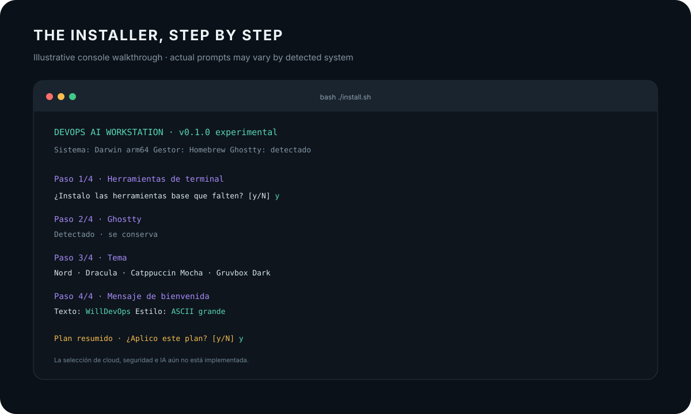

# Screenshots & quick guide

The images on this page are **visual mockups** that show the intended look and the current installer flow. They are not screenshots from a real machine. The installer is experimental, and only the Homebrew base-tool installation is currently implemented on macOS.

## Ghostty themes

The installer offers four curated theme names. The palettes below are representative previews; Ghostty's installed theme may have slightly different exact colors depending on its version.



Choose one at the Ghostty theme prompt. Ghostty itself can show its full installed theme list with:

```bash
ghostty +list-themes
```

To change themes later, edit the `theme = ...` line in `~/.config/ghostty/config.ghostty` (or the existing legacy `config` file). Reload Ghostty with **Cmd+Shift+,** on macOS or **Ctrl+Shift+,** on Linux. If the installer changes an existing config, it makes a timestamped backup first.

## Welcome message

The optional welcome message is printed when Zsh starts interactively. You can enter a name, team label, or short phrase, such as `WillDevOps` or `DevOps Workstation`.

- **ASCII large letters:** uses `figlet` if installed; otherwise shows a text frame.
- **Simple:** prints a compact decorated line.

The installer stores your message as plain text under `~/.config/workstation/`. It does not run the text as shell code.

## What the console flow looks like



## Commands you can use now

Run from the cloned repository:

```bash
bash ./install.sh
```

This opens the interactive setup. In a capable terminal, move through the tool list with ↑/↓, press Space to select tools, then press Enter. Press `a` to select all base tools or `c` to clear the list. Choose a Ghostty theme with ↑/↓ and Enter, then optionally set a welcome message and confirm the plan. Terminals without arrow-key support use text prompts.

Other useful commands:

```bash
bash ./install.sh --help
./scripts/workstation/workstation doctor
./install.sh --with zsh,starship,fzf --theme Nord --welcome WillDevOps
```

The last example specifies base tools, a Ghostty theme, and an ASCII welcome message. It still asks for confirmation unless `--yes` is supplied. Avoid `--yes` unless you have reviewed the plan and are comfortable with automatic Homebrew installation.

## What is selectable today

| Area | Available now | Still planned |
| --- | --- | --- |
| Terminal tools | Zsh, Starship, zoxide, fzf, ripgrep, jq, eza, bat, Atuin, tmux, figlet | Linux package-manager installation |
| Ghostty | Optional Homebrew install, four curated themes, config backup | Interactive browse of all installed Ghostty themes |
| Welcome | Custom text, ASCII or simple style | Per-terminal targeting and richer saved profiles |
| Cloud, security, AI | Tool catalog in `docs/MANIFEST.md` | Profile selection and installation |
| MCP and skills | Three portable example skills; least-privilege guidance | `workstation mcp` and `workstation skills` management commands |

Use `./scripts/workstation/workstation doctor` to see which shell tools are present. Cloud, security, AI, update, and theme-management CLI commands are not implemented yet; the README and CLI say so explicitly.
